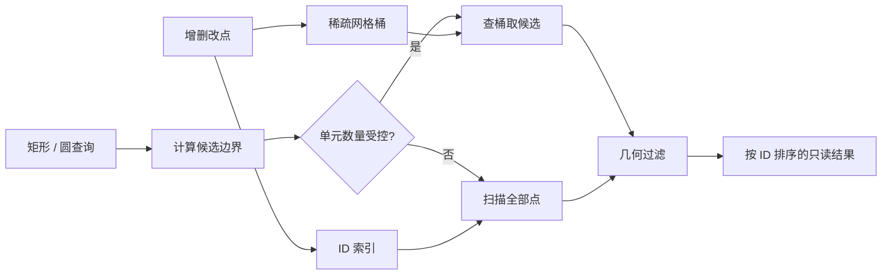

# Spatial Query Engine

可动态增删改的二维点空间索引。稀疏均匀网格缩小候选集合，再执行矩形或圆形精确过滤；超大查询自动切换全量扫描，避免遍历海量空网格。

**项目性质：2026-10-30 新建，AI 辅助实现的独立技术演示。用于研究和面试讨论，不是雇主源码、历史商业成果或生产级物理引擎。**

## 快速运行

需要 .NET SDK 9；无第三方 NuGet 依赖。

```powershell
dotnet run --project demo/SpatialDemo -c Release
dotnet run --project tests/SpatialQuery.Specs -c Release
```

演示创建 10000 个点，执行局部圆形查询、跨单元移动和全局查询，并输出候选检查数量。这个数量用于说明查询过程，不是吞吐量基准。

## 工程重点

- **动态双索引**：ID → 点快照与 Cell → ID 集合；更新先验证坐标，跨单元移动清理旧桶，删除空桶。
- **负坐标正确分桶**：使用 `floor`，避免向零截断把零两侧错误合并。
- **闭区间查询**：矩形边界包含，圆形查询过滤方形候选区域中的角点。
- **浮点边界**：圆形距离使用二次幂缩放，避免平方溢出及除以半径导致的经典勾股边界误差；候选包围盒向外扩展一个 ULP。
- **退化保护**：按查询面积、候选上界和配置阈值选择网格或全量扫描，巨大查询不逐格访问。
- **可观察结果**：返回候选数量、访问单元数、是否使用全量扫描；结果按 ID 稳定排序。



## 验证

21 项可执行规格，包含负坐标、零半径、边界点、重复 ID、跨桶移动、无效更新的原子性、稳定排序和空桶回收。独立暴力模型执行：

- 4 种网格尺寸 × 2500 次固定种子随机增删改操作，共 10000 次变更。
- 每次操作同时对照矩形与圆形查询，共 20000 次查询，验证 ID 集合及载荷一致性。
- 极大坐标、半径与包围盒溢出；勾股边界和单元坐标极值；局部查询实际减少候选。

GitHub Actions 在 Linux 上构建并运行规格和演示。

## 范围与取舍

这是 .NET 9 单线程点索引，未实现碰撞响应、对象面积、最近邻搜索或 Unity 适配。坐标必须有限，存储单元坐标限定在 ±1000000000。几何判定遵循 IEEE 754 double 运算，不提供任意精度的稳健几何保证；载荷 `T` 的内部可变对象不会被深拷贝。稠密聚簇最坏仍需 O(N) 扫描。更多不变量、复杂度和数值边界见 [设计说明](docs/design.md)。

MIT License。
